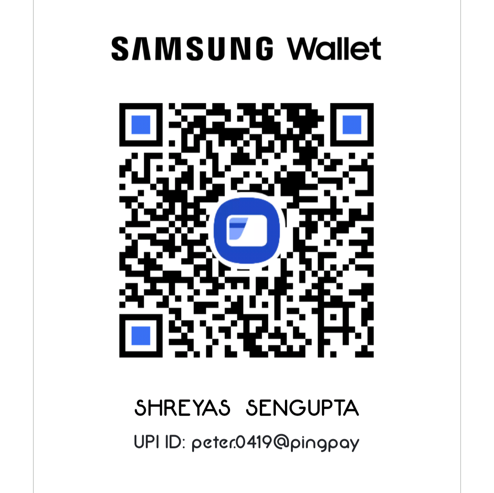

# Samsung One UI App Locker 🛡️

A production-ready, zero-bloat native Android App Locker built in 100% Kotlin and Jetpack Compose, strictly adhering to the Samsung One UI design philosophy. Built specifically for Samsung Galaxy devices, supporting **Android 11 (One UI 3.x / API 30) through Android 15+ (One UI 7.x / API 35)**.

---

## ✨ Features & Highlights

- **Dual Authentication Engines:**
  - **Samsung System Credentials:** Seamlessly invokes native Samsung Face, Fingerprint, and device PIN/Pattern/Password via `androidx.biometric.BiometricPrompt`.
  - **App-Specific Custom PIN:** Allows setting a dedicated 4–6 digit custom secret PIN with salted SHA-256 encryption. Supports biometric bypass while falling back directly to your app PIN (instead of the phone's lock code).
- **App Hiding (Launcher & Finder Hiding):**
  - Seamlessly integrates with Samsung One UI Home's native *"Hide apps on Home and Apps screens"* settings.
  - Supports automatic system-level hiding and unhiding of locked apps via ADB Device Owner privileges.
- **Self-Lock & Anti-Bypass Protection:**
  - The App Lock settings dashboard itself is protected by an impenetrable authentication gate. Even if searched up and opened via Google Play Store, Samsung Galaxy Store, or system Settings, unauthorized users cannot access settings or disable protection.
- **Anti-Uninstall Protection (Device Administrator):**
  - Integrates with Android's `DevicePolicyManager`. Once activated, unauthorized users cannot uninstall App Lock without deactivating Device Administrator privileges first.
- **One UI 6 / 7 Flagship Design System:**
  - True AMOLED Black (`#010101`) dark theme and Samsung Light (`#F6F6F8`).
  - Signature Samsung Blue accent (`#0381FE`).
  - `26.dp` grouped card containers with `1.dp` hairline dividers (inset `68.dp`).
  - Collapsible One UI Expanding App Bar (top 35% title header with one-handed reachable bottom 65%).
  - Squircle `44.dp` app icons and authentic Samsung lock screen keypad (`76.dp` circular keys, letters, animated dots, and haptic feedback).
- **App Launch Interception Engine:** Battery-optimized `AccessibilityService` listening strictly to `TYPE_WINDOW_STATE_CHANGED` with in-memory `Set<String>` synced via Kotlin Flow for $O(1)$ instantaneous interception.
- **100% Opaque Solid Privacy Backdrop:** Guarantees 0% visual leakage of sensitive underlying application content (e.g. WhatsApp chats, bank accounts, photos), backed by `FLAG_SECURE` against screenshots and Recent Apps previews.
- **Notification Guard & Content Masking:** Intercepts notifications for locked applications using `NotificationListenerService`, suppressing sensitive previews and replacing them with One UI masked alerts (*"Contents hidden • Unlock app to view"*), preserving underlying `PendingIntent`s.
- **Hardware-Backed Encryption:** Stores lock preferences and session states inside `EncryptedSharedPreferences` via Jetpack Security (AES-256 GCM + AES-256 SIV).
- **Split-per-ABI Signed Builds:** Native ABI splits for `arm64-v8a`, `armeabi-v7a`, `x86_64`, and Universal APKs with automated GitHub Releases CI/CD.

---

## 📱 Compatibility Matrix

| OS Version | One UI Version | API Level | Native Biometrics | Notification Runtime Perm |
|---|---|---|---|---|
| **Android 11** | One UI 3.0 / 3.1 / 3.5 | API 30 | BiometricPrompt + Fallback | Auto-Granted via Channel |
| **Android 12 / 12L** | One UI 4.0 / 4.1 / 4.1.1 | API 31 / 32 | BiometricPrompt + Custom PIN | Auto-Granted via Channel |
| **Android 13** | One UI 5.0 / 5.1 / 5.1.1 | API 33 | BiometricPrompt + Custom PIN | `POST_NOTIFICATIONS` Runtime Check |
| **Android 14** | One UI 6.0 / 6.1 / 6.1.1 | API 34 | BiometricPrompt + Custom PIN | `POST_NOTIFICATIONS` Runtime Check |
| **Android 15+** | One UI 7.0+ | API 35 | BiometricPrompt + Custom PIN | Predictive Back & SDK 35 Insets |

---

## 🚀 Setup & Installation Guide on Samsung Galaxy

### 1. Download Release APK
Download the signed APK matching your phone's architecture from the [GitHub Releases](../../releases) section:
- **`app-arm64-v8a-release.apk`** (Recommended for almost all modern Samsung Galaxy S, Z, A, and M series phones).
- **`app-universal-release.apk`** (Universal fallback APK compatible with all devices).

### 2. Enable Accessibility Service (App Interception)
1. Open the App Lock app.
2. Under **Required Permissions & Security**, tap **Enable** next to *App Interception Service*.
3. Tap **Installed apps** > **App Lock Interception Service**.
4. Toggle **On** and tap **Allow**.

> [!IMPORTANT]
> **Android 13+ "Restricted Settings" Bypass:**
> If Samsung Knox or Android 13+ greys out the Accessibility switch with a *"Restricted setting: For your security, this setting is currently unavailable"* alert:
> 1. Long-press the **App Lock** icon on your home screen or app drawer and tap the **(i)** Info icon (or go to **Settings > Apps > App Lock**).
> 2. In the top-right corner, tap the **⋮ (three dots)** menu.
> 3. Select **Allow restricted settings**.
> 4. Verify with your fingerprint or PIN, then return to Accessibility settings and toggle the service on.

### 3. Activate Device Administrator (Anti-Uninstall Protection)
1. In the **Security & Protection** section, tap the **Anti-Uninstall Protection** row or toggle.
2. The Samsung Device Administrator activation screen will appear. Tap **Activate** to grant protection.
3. Once active, the app cannot be uninstalled from the home screen or settings menu without first deactivating Device Admin in **Settings > Security and privacy > More security settings > Device admin apps**.

### 4. Enable Notification Guard (Content Masking)
1. Tap **Enable** next to *Notification Guard*.
2. Locate **App Lock Notification Guard** in Device & App Notifications and toggle it **On**.
3. Allow Notification Access.

### 5. Custom App PIN vs. Phone Screen Lock
- **Phone Screen Lock:** Seamlessly uses Samsung's native biometric sheet (Fingerprint, Face Unlock) with phone PIN/Pattern fallback.
- **Dedicated Custom App PIN:** Set an independent 4–6 digit PIN hashed with salted SHA-256. When active, **only** the custom Samsung One UI PIN keypad is displayed with zero system biometric sheet interference.

### 6. App Hiding & Play Store Protection
- **App Lock Dashboard Protection:** App Lock itself stays readily accessible in your app drawer, protected by the **Lock App Lock Itself** gate so unauthorized users cannot access or disable locks.
- **Hide Locked Apps from Launcher & Search:**
  - **Option 1 (Instant / No PC):** Tap the toggle in App Lock and select **"Open Home Screen Settings"** to directly access Samsung One UI Home's native *"Hide apps on Home and Apps screens"* list.
  - **Option 2 (Automatic Background Hiding via ADB):** Run this one-time command from your PC to grant Device Owner privileges:
    ```bash
    adb shell dpm set-device-owner com.samsung.oneui.applock/.receiver.AppLockDeviceAdminReceiver
    ```
    Once granted, App Lock can hide and unhide any locked app automatically at the OS level!
- **Guard Play Store & Settings:** Blocks intruders from searching for locked apps on Google Play Store to tap "Open", or navigating into Settings to alter permissions.

---

## 🏛️ Architecture Overview

```
com.samsung.oneui.applock
├── AppLockApplication.kt          # Global Application & Notification Channel bootstrapping
├── data
│   ├── model
│   │   ├── AppInfo.kt             # UI model for installed applications & lock states
│   │   └── LockSettings.kt        # Master toggles, notification scope, auth mode, stealth
│   ├── pref
│   │   └── EncryptedPreferencesManager.kt # Jetpack Security EncryptedSharedPreferences & Flow
│   └── repository
│       └── AppLockRepository.kt   # Clean Repository coordinating PackageManager & EncryptedPrefs
├── receiver
│   ├── AppLockDeviceAdminReceiver.kt # Device Administrator for Anti-Uninstall Protection
│   └── BootReceiver.kt            # Warmed-up cache initialization on device reboot
├── service
│   ├── AppLockAccessibilityService.kt # Window state change interceptor (O(1) in-memory lookup)
│   └── NotificationGuardService.kt    # Sensitive notification interception & content masking
├── ui
│   ├── components
│   │   ├── OneUICard.kt           # 26.dp rounded container with 68.dp inset dividers
│   │   ├── OneUIExpandingAppBar.kt# Collapsible One UI 35% header with standard top bar
│   │   ├── OneUISearchBar.kt      # One UI pill search input
│   │   └── OneUISwitch.kt         # Custom One UI pill switch
│   ├── lock
│   │   ├── LockOverlayActivity.kt # Native BiometricPrompt + Custom PIN keypad overlay
│   │   └── OneUIPinKeypad.kt      # Samsung Galaxy styled 3x4 numeric circular keypad
│   ├── main
│   │   ├── AppLockSelfAuthScreen.kt# Master authentication gate for App Lock itself
│   │   ├── CustomPinDialog.kt     # Custom PIN setup & change dialog
│   │   ├── MainActivity.kt        # Root launcher activity with self-lock gating
│   │   ├── MainScreen.kt          # One UI Master dashboard & application list
│   │   ├── MainViewModel.kt       # MVVM StateFlow coordinator
│   │   ├── PermissionCard.kt      # Permissions & Security onboarding with deep links
│   │   └── PermissionState.kt     # Permission & Device Admin status evaluation
│   └── theme
│       ├── Color.kt               # AMOLED #010101, Light #F6F6F8, Samsung Blue #0381FE
│       ├── Shape.kt               # 26.dp cards, 13.dp squircles, 50% pill buttons
│       ├── Theme.kt               # One UI Compose theme provider
│       └── Type.kt                # Typography scale matching Samsung One UI guidelines
└── util
    ├── PermissionHelper.kt        # System permission & Device Admin checkers
    └── SystemPackageFilter.kt     # SystemUI and launcher package resolution
```

---

## ⚙️ Building Locally

Ensure you have **JDK 17** installed and configured:

```bash
# Clone the repository
git clone https://github.com/peter14l/samsung-oneui-applock.git
cd samsung-oneui-applock

# Build Debug APK
./gradlew assembleDebug

# Build Release Split APKs (using release-keystore.jks)
export RELEASE_KEYSTORE_PASSWORD="<password>"
export RELEASE_KEY_ALIAS="applock-release-key"
export RELEASE_KEY_PASSWORD="<password>"
./gradlew assembleRelease
```

Generated APKs will be located under `app/build/outputs/apk/release/`.

---

## 🔒 Security & Privacy

- **No Network Permissions:** `android.permission.INTERNET` is **NOT** declared in `AndroidManifest.xml`. Zero telemetry, zero analytics, zero data leaving your device.
- **Hardware Keystore:** AES keys are bound to the Android Keystore hardware security module (StrongBox / TEE).
- **Direct Biometrics:** Biometric credentials never pass through app memory; authentication is handled solely by the OS `BiometricPrompt`.

---

## 💖 Support the Project & Donations

Samsung One UI App Locker is 100% free, open source, and built with zero advertisements, zero tracking, and zero telemetry. If this project helps protect your Samsung Galaxy phone, consider supporting development!

### 📱 Pay via UPI / Samsung Pay / GPay / PhonePe

<p align="center">
  
</p>

- **UPI ID:** `peter.0419@pingpay`
- **Supported Apps:** Samsung Pay, Google Pay, PhonePe, Paytm, CRED, BHIM, or any UPI-enabled banking app.

---

## 📄 License
Distributed under the Apache 2.0 License. Built with ❤️ for Samsung One UI lovers.
